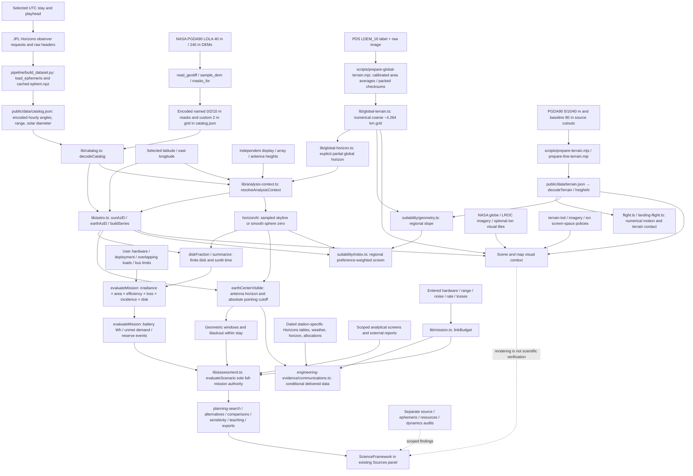

# Source-to-output pipeline

This reference describes the installed source paths, not a scientific pass or operational approval. Separate audits supply dated findings. Missing findings in `ScienceFramework` mean **audit pending**. A verified finding is valid only for its declared scope and input identity. Range/ephemeris repairs are accepted through new source evidence and identities; this document does not freeze an in-progress discrepancy as permanent status.

`ScienceFramework` receives context and findings only. It imports no engine, fetches nothing, stores nothing, and computes no scientific status or mission result. The graph is explanatory metadata in `lib/science-framework.ts`. Its links disclose hand-authored native MathML, actual engine symbols, units, intuition, checking approach and limits. Public focuses on why, Educator opens equations and suggests controlled experiments, Planner emphasizes validation and qualification gaps. The parent owns integration into Sources, audit compilation and dataset/version binding.

## Coordinate and time boundaries

[PGDA product 90](https://pgda.gsfc.nasa.gov/products/90) explicitly declares MOON_ME of DE421 and south-polar stereographic X/Y metres. Source-to-input orientation alignment remains uncertain; an identical-looking frame name is not proof of equivalence. Inspect the actual catalog ephemeris and frame metadata, raw Horizons headers, transform kernels, body orientation and time conversion. Do not infer that a new station-specific frame transform validates the old catalog/masks.

The UI/mission stay is UTC with an exclusive end. Environmental forcing is hourly; the final catalog epoch is an endpoint only. Time interpolation in `poseAt` animates a view; operations subsegments split existing forcing. Neither adds measurements. TDB belongs to dynamical ephemeris/vector conventions where requested; a qualified boundary must convert UTC/TDB explicitly and retain leap-second/EOP/kernel provenance. [Horizons AIRLESS](https://ssd.jpl.nasa.gov/horizons/manual.html) removes atmospheric refraction but leaves apparent observer/light-time conventions. Reversing observer and target is not a safe apparent-range substitution.

Moon-fixed Cartesian coordinates produce local east/north/up directions. Flight state uses east/up/north metres. Scene geometry maps east/up/minus-north and kilometre units (`scene/surface.ts::flightVector`, `bodyToScene`, `skyDirection`). Display globes, optional ion frames and numerical terrain retain independent source identities/transforms. Do not use visual orientation as quantitative source-alignment proof.

## Position verification is a chain

1. Preserve exact target, observing centre, source epoch/time system, correction mode, frame, station/site coordinates, units, raw response and checksum. Check all source epochs and range direction independently of angle.
2. `pipeline/build_dataset.py::validate_against_observer` compares derived local Sun/Earth geometry with direct lunar-site observer tables. Startup analytic tests catch gross conventions.
3. `scripts/verify-horizons.ts` compares **decoded client** Sun/Earth AZ/EL to fresh Horizons observer rows, accounting for wrapped azimuth and quantization. Its bounded sample coverage cannot establish all-epoch correctness, range correctness or terrain occlusion.
4. `lib/engineering-evidence/horizons.ts` validates station request/response identity, ITRF93, airless apparent columns, units and complete hourly UTC coverage. Archived station CSPICE comparisons have their own scope and evidence identity.
5. Reproduction requires fixed tolerances, observed residuals, reference version, coverage and independent evidence. Same JPL data through another calculation validates implementation, not independent observation. Skipped/network-failed checks remain unverified. Consume fresh supplied findings; historical counts are not a current pass.

## Heights and data products

Display observer height affects the view. Array height determines the solar mask used by `evaluateMission`; antenna height determines the independent contact mask. Named prepared masks are 0, 2 and 10 m. Custom prepared masks are nearest 2 m grid cells with their actual cell coordinates/distance; no safe borrowing distance is assumed. `resolveTerrainChoice` currently restricts scenario heights to 0/2/10 m before choosing a mode. The lower-level coarse-global function supports a broader height domain, which does not extend the scenario contract.

Original prepared masks use 40 m DEM with 240 m fallback, 1° named/3° custom azimuth, sampled spherical rays. Named radial steps progress 40/160/400 m to 250 km. Custom rays use 160/400/800 m to 200 km. Narrow ridges between rays/samples and quantized horizon values limit event accuracy. Fine display DEM patches are a separate branch and never recompute the old masks.

Global coarse fallback uses calibrated PDS LDEM_16 V3.1 source cells of 1895.21 m, area-averaged to about 4264.22 m equatorial output spacing. `terrainForGlobal` traces 2° azimuth with 200 logarithmic distances from 1 m to 1000 km. Near interpolation recovers no fine structures. Coverage and physical accuracy remain partial/unquantified; unknown rays stay unknown.

## Zoom selects display detail

| Selection | Actual source policy | Meaning and limit |
| --- | --- | --- |
| Local numerical height | `terrain.ts::heightAt`: covered patches prioritized by input pixel size, four-cell bilinear interpolation; baseline overview fallback when allowed | Actual `stepM`, `stepYM`, `inputPixelM` belong to the asset. `localOnly` excludes overview; display global fallback does not qualify collision support. |
| Fine patch preparation | `prepare-fine-terrain.mjs`: 5 m source at latitude ≤−87°, 10 m at ≤−83°, otherwise 40 m where covered; 513² cutouts, nominal half-widths 2048/6144/8192 m | Output about 8/24/32 m before source-window alignment; distinguish source pixels from actual output spacing. Coverage/nodata still apply. |
| Baseline patch / overview | `prepare-terrain.mjs`: 80 m source with COG overview selection relative to requested grid | Committed baseline patch samples can use 160 m input pixels at ~128 m output; overview ~1185 m output from 1280 m input. These are data snapshot examples, not physical accuracy. |
| Local display mesh | `terrainDetailPolicy`: 384 segments; 640 when max(input pixels, output step) ≤80 m and range <2 km; retain 640 until 5 km | 500 ms runtime debounce. Supported local data at range <50 km sets close-view flag; global display also depends on mode and body-centred distance >1850 km. Triangle density changes no science evidence. |
| WAC / NAC imagery | `imagery.ts::onlineNacLevel`: NAC only when screen sampling ≤100 m/px by default; level clamp(ceil(log₂(8561.953125/s)), 2, 10), tile output 8561.953125/2^level m/px; 24-tile viewport budget | May lower level to cover view; never claim NAC everywhere. SourcePixelM and stepM differ: 39 m output from WAC remains 100 m source information. |
| NASA globe | Original [NASA LRO visualization geometry](https://svs.gsfc.nasa.gov/14959/) and extracted atlas | Global context and historical image lighting; no scientific terrain/hazard accuracy inferred. |
| Optional ion mesh | `lib/ion/limits.ts`: 2 px screen-space error, 300 tiles/128 MiB maximum cache, four downloads/one parse; camera-local refinement | Visual only, no fixed metre resolution guarantee. Viewing-camera surface constraints may use streamed geometry; numerical vehicle collision and calculations remain tied to DEM. Offline falls back to bundled data. |

Source pixel spacing, output grid spacing, effective resolution and accuracy are separate quantities. Historical LROC image illumination is acquisition-time context; changing the epoch or inspection light does not turn it into a simulation of selected-date shadows.

## Integration and acceptance boundary

Export: `components/science-framework/index.tsx::ScienceFramework({mode, context?, findings?})`. Context carries latitude, east longitude, UTC epoch, distinct observer/array/antenna heights, terrain mode/label, dataset ID and model version. No demo values or wall-clock fallback. Findings carry `id`, `claim`, `status`, `scope`, `limitations`, `sourceUrls`; supplied states are displayed verbatim in meaning and never promoted. Empty/absent findings both mean pending. Caller must bind audit scope to actual context; the narrow props do not contain a machine-checkable evidence identity.

Worker scope excludes Navigator wiring, scientific changes, audits, package changes, shared styles, app servers and web/offline builds. Parent must inspect integrated rendering, keyboard disclosure and hide/restore, narrow/200% reflow, native MathML on target browsers and real screen-reader behavior; these are separate from worker SSR/static layout checks. No operational qualification, general accessibility conformance or all-green science claim follows.

## Worker verification · 15 November 2026

- Seven focused tests pass, zero skipped: graph completeness/acyclic dependencies, 23 native equation blocks, readable SSR, all audiences, exact caller context and independent heights, missing/empty findings, supplied statuses/scopes/limitations, source URL handling and instance anchor completeness.
- `npm run typecheck -- --incremental false` and repository-wide `npm run lint` pass. No science engine/data was edited and no Horizons audit was run by this worker. `slop-scan` is unavailable on PATH; no extra tool was installed.
- An isolated headless Chrome page loaded the actual component with existing theme CSS over `file:`, with no app server/shared browser profile. Dependency links disclose the target card; hide/restore works. Rendered inspection covered the pending state and native RF equation. Page reflow passed at 320/640/1280 px and 200% CSS zoom; no HTTP requests occurred. These are bounded component checks, not integrated app, native browser zoom, target-device or screen-reader acceptance.
- The linked DAG has 23 engine/input cards, six source-to-output paths, six resolution policies and five qualification gates. Native symbol definitions are authored beside equations, with no generated MathML registry or additional dependency. Source-to-input alignment remains uncertain and no operational qualification is claimed.
- Parent still owns Sources-panel wiring, findings/dataset binding, compiled audit JSON, any updated source data, global styles, packages, full builds and generated offline artifacts. Durable integration notes and limits are preserved here within worker ownership; the shared external vault was not changed.
